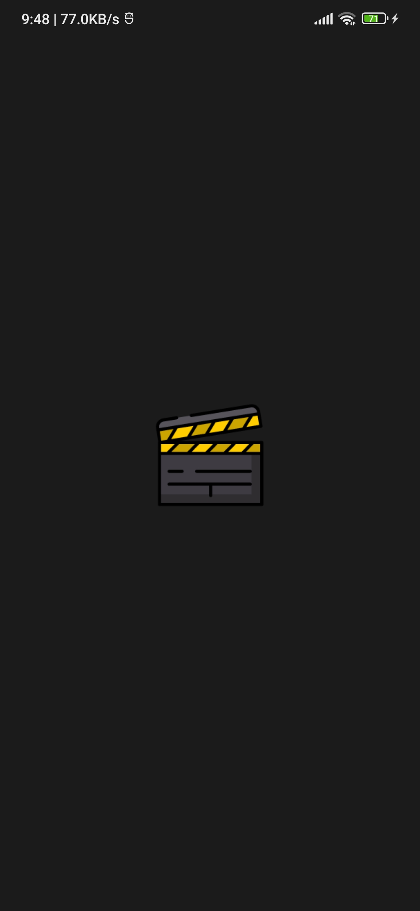
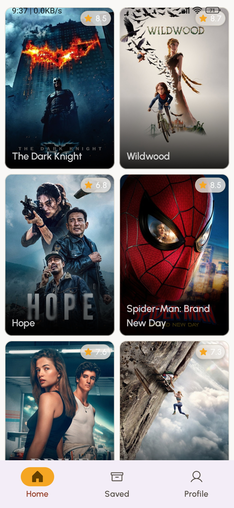
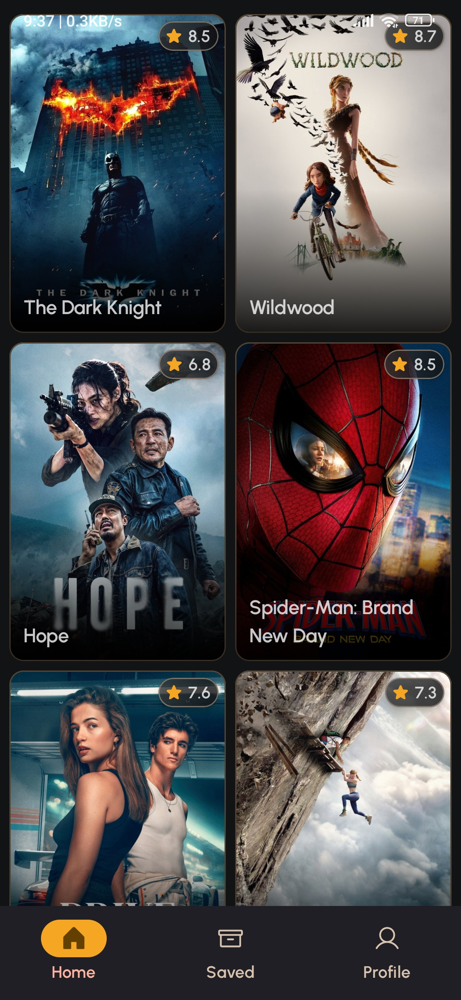
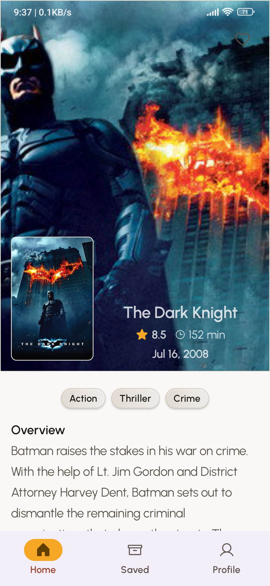
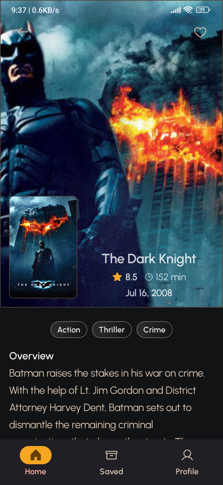
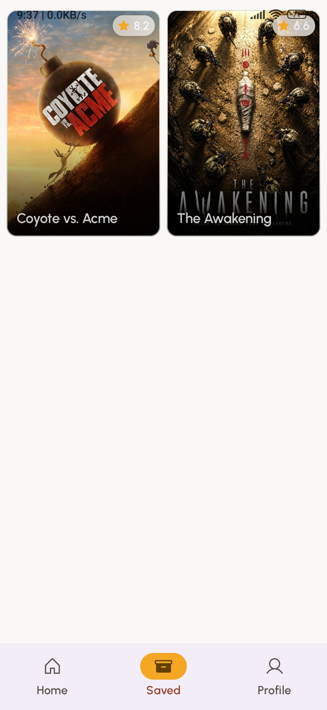
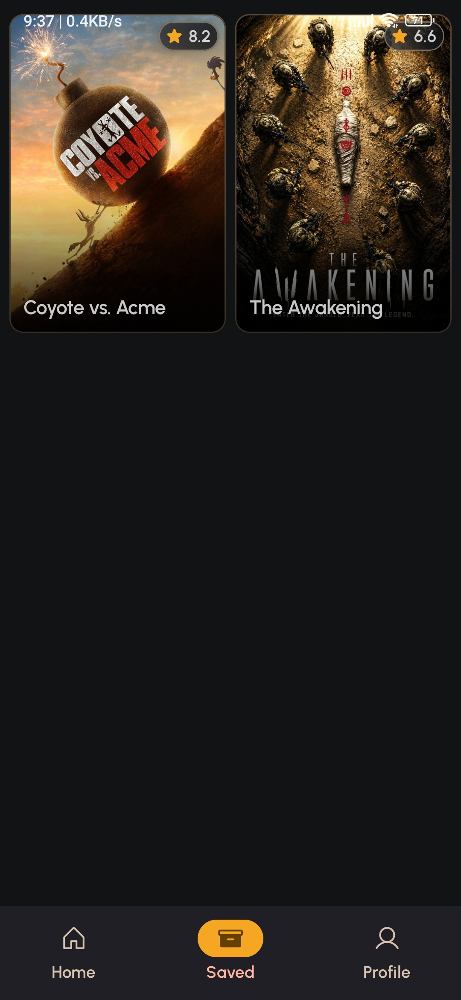
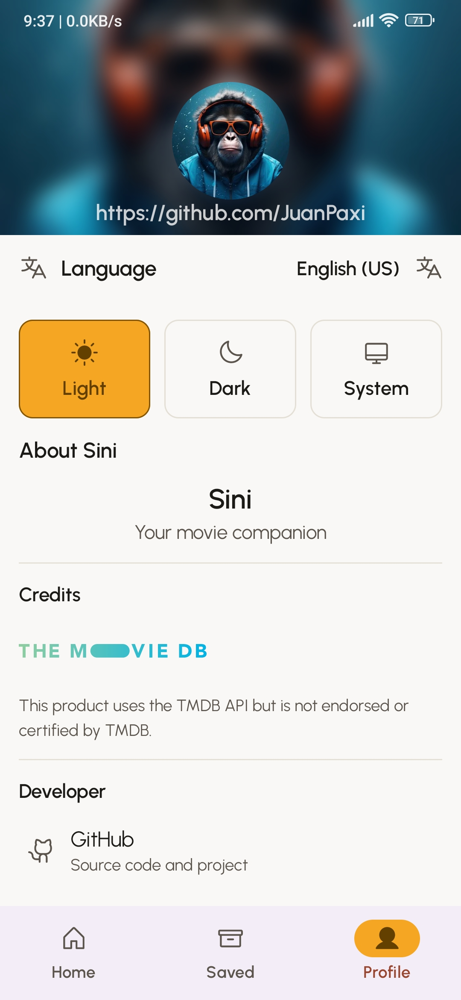
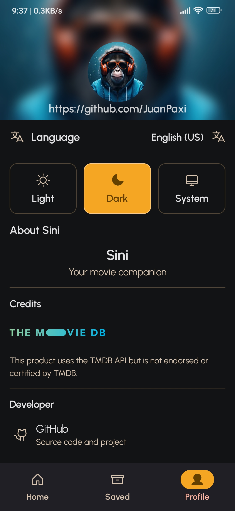

# Sini

<p align="center">
  
</p>

**Sini** is an Android application for discovering and exploring movies. Built with Kotlin and Jetpack Compose, it uses a modular architecture and an offline-first data layer to provide a responsive movie browsing experience.

## Screenshots

### Splash Screen



### Home

| Light Theme | Dark Theme |
|---|---|
|  |  |

### Movie Details

| Light Theme | Dark Theme |
|---|---|
|  |  |

### Bookmarks

| Light Theme | Dark Theme |
|---|---|
|  |  |

### Profile

| Light Theme | Dark Theme |
|---|---|
|  |  |

## Features

### Home
- Browse popular movies in a two-column grid.
- Paginated movie loading with Paging 3.
- Automatic data synchronization with a one-hour cache interval.
- Local caching and network-aware data loading.
- Loading, error, and retry states.

### Movie Details
- View movie information, artwork, genres, and ratings.
- Read movie descriptions and release information.
- Add or remove movies from favorites.

### Bookmarks
- Browse saved movies in a two-column grid.
- Reactive updates when favorites change.
- Dedicated empty state.
- Navigate to movie details.

### Profile and Settings
- Configure the app theme: light, dark, or follow system.
- Persist theme preferences across app sessions.
- View application information.
- Display TMDB attribution and credits.

## Tech Stack

| Category | Technologies |
|---|---|
| Language | Kotlin |
| UI | Jetpack Compose, Material 3 |
| Dependency Injection | Hilt |
| Networking | Retrofit, OkHttp, Kotlinx Serialization |
| Image Loading | Coil |
| Local Database | Room |
| Preferences | DataStore, Protocol Buffers |
| Pagination | Paging 3 |
| Navigation | Navigation 3 |
| Asynchronous Programming | Kotlin Coroutines and Flow |
| Testing | JUnit, Truth, Mockito-Kotlin |

## Architecture

Sini follows a modular architecture inspired by Google's [Now in Android](https://github.com/android/nowinandroid) project.

The application separates UI features, data management, networking, local persistence, and shared components into dedicated Gradle modules.

### Core Modules

| Module | Responsibility |
|---|---|
| `core:common` | Shared utilities and common functionality |
| `core:model` | Shared application models |
| `core:network` | Network interfaces, TMDB integration, and demo data source |
| `core:database` | Local persistence using Room |
| `core:data` | Repository implementations and data coordination |
| `core:datastore` | Persistent user preferences |
| `core:datastore-proto` | Protocol Buffers definitions for DataStore |
| `core:datastore-test` | DataStore testing utilities |
| `core:designsystem` | Theme and reusable UI components |
| `core:navigation` | Shared navigation infrastructure |

### Feature Modules

| Module | Responsibility |
|---|---|
| `feature:home` | Popular movies |
| `feature:detail` | Movie details and favorites |
| `feature:bookmark` | Saved movies |
| `feature:profile` | Profile and app settings |

The `app` module integrates the application components and provides the Android application entry point.

## Build Variants

Sini provides two product flavors:

| Flavor | Data Source | Purpose |
|---|---|---|
| `demo` | Local JSON assets | Development and demonstration without depending on the TMDB API |
| `prod` | TMDB API | Real movie data from TMDB |

Both flavors use the same network data source abstraction. Hilt binds the appropriate implementation according to the selected source set.

## Getting Started

### Requirements

- Android Studio
- JDK 17
- Android SDK

### Clone the Repository

```bash
git clone https://github.com/JuanPaxi/Sini.git
cd Sini
```

### Run the Demo Version

The demo flavor uses bundled JSON assets and does not require a TMDB API key.

You can select `demoDebug` in Android Studio or build the application using:

```bash
./gradlew assembleDemoDebug
```

### Run the Production Version

The production flavor retrieves movie data from the TMDB API and requires an API key.

Create or update the `local.properties` file in the project root:

```properties
API_KEY=your_tmdb_api_key
```

The API key is read by the network module and added to TMDB requests through an OkHttp interceptor.

Select the `prodDebug` build variant in Android Studio to run the production version.

**Security note:** Do not commit `local.properties` or expose your API key in public repositories. API keys embedded in distributed Android applications can still be extracted.

## Testing

The project includes unit tests and Android instrumented tests covering data repositories, database operations, and synchronization logic.

Run unit tests:

```bash
./gradlew test
```

Run database instrumented tests:

```bash
./gradlew :core:database:connectedDebugAndroidTest
```

Run data layer instrumented tests:

```bash
./gradlew :core:data:connectedDemoDebugAndroidTest
```

## Acknowledgements

- [Now in Android](https://github.com/android/nowinandroid) — inspiration for modern Android development practices and modularization.
- [The Movie Database (TMDB)](https://www.themoviedb.org/) — movie data and images.

This product uses the TMDB API but is not endorsed or certified by TMDB.

## License

Sini is licensed under the [Apache License 2.0](LICENSE).
